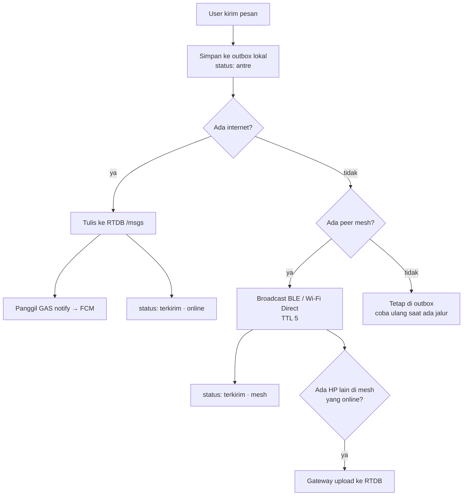
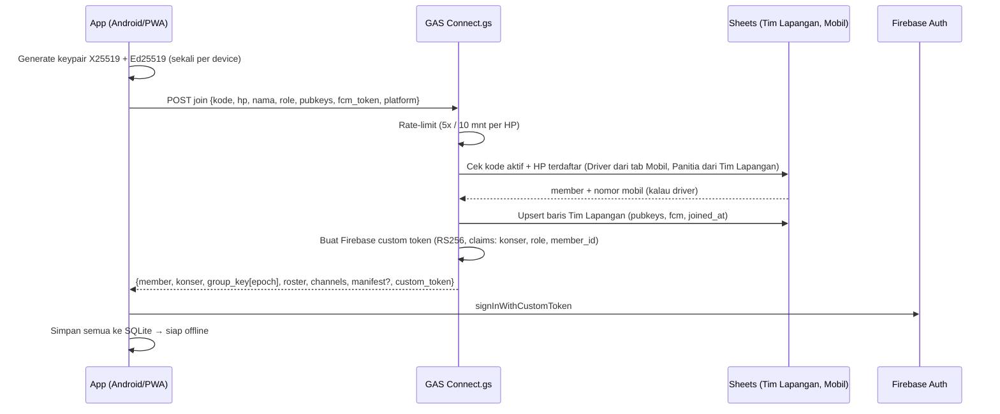
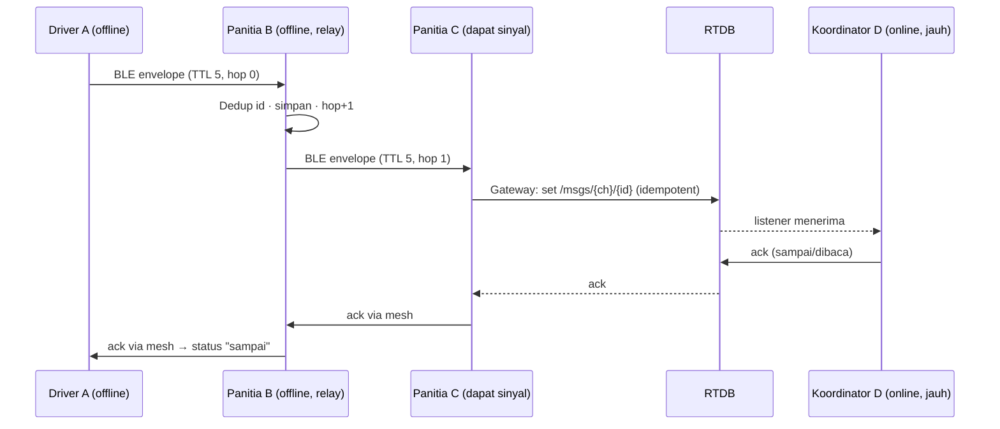
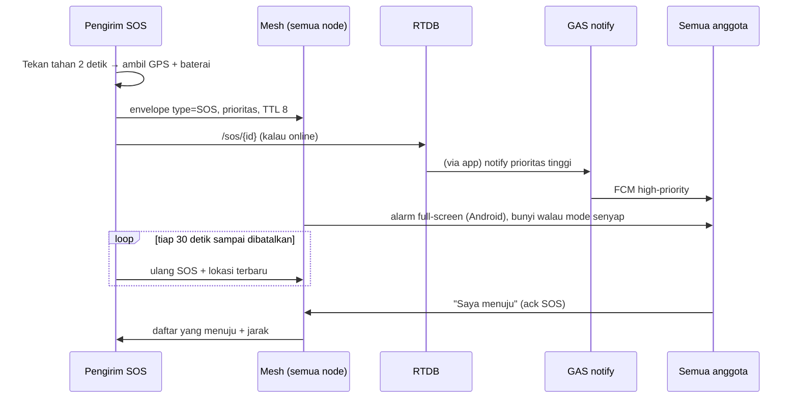
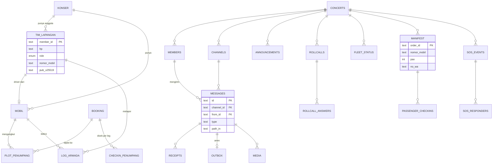

# PRD Sistem — CarterTag Connect

> Aplikasi komunikasi lapangan driver & panitia CarterTag. Jalan **dengan atau tanpa internet**.
> Dokumen ini acuan eksekusi di VSCode + Claude Code. Pasangannya: `PRD-UIUX-CarterTag-Connect.md`.

| | |
|---|---|
| Versi dokumen | 1.0 — 19 Nov 2026 |
| Pemilik | Reza (CarterTag) |
| Sistem induk | CarterTag System (GAS) — `C:\xampp\htdocs\cartertag new\sistem` |
| Prinsip biaya | **Rp 0**: semua layanan pakai paket gratis. iOS native ditunda (lihat §12.4). |

---

## 1. Ringkasan & Tujuan

**Masalah.** Di hari konser, ribuan orang berkumpul di satu area dan sinyal seluler ambruk. Driver di parkiran dan panitia di gerbang jadi tidak bisa koordinasi: titik jemput pindah, jam pulang berubah, penumpang hilang, ada mobil mogok. Grup WhatsApp yang sekarang dipakai mati total tanpa internet.

**Solusi.** CarterTag Connect: aplikasi chat **hybrid**.
- Ada sinyal (walau lemah) → pesan lewat internet (Firebase), jarak tak terbatas.
- Sinyal mati → otomatis pindah ke **mesh** antar-HP (Bluetooth LE + Wi-Fi Direct). Pesan bisa melompat lewat HP anggota lain.
- Pesan yang belum sampai disimpan, lalu dikirim ulang begitu ada jalur.
- Satu HP yang dapat sinyal otomatis jadi **gateway**: pesan mesh diteruskan ke internet, dan sebaliknya.

**Pengguna.**

| Role | Siapa | Kebutuhan utama |
|---|---|---|
| Driver | Sopir armada shuttle | Terima instruksi, lapor status mobil, lihat manifest penumpang |
| Panitia | Crew lapangan / PIC yang ikut ke lokasi | Chat grup & pribadi, bantu cari penumpang, absen |
| Koordinator | Ketua lapangan per konser | Semua fitur panitia + pengumuman, papan armada, kelola anggota |
| Admin Console | Pengguna CarterTag Console (GAS) dengan izin menu "Tim Lapangan" | Generate kode, kelola anggota, monitor dari web |

**Platform.**

| Platform | Bentuk | Kemampuan |
|---|---|---|
| Android 8.0+ | App Flutter (APK) | Node penuh: online + mesh BLE + Wi-Fi Direct + gateway + jembatan iPhone |
| iPhone / browser apa pun | Web app (PWA) dari codebase Flutter yang sama | Online penuh. Offline lewat **Mode Jembatan**: konek ke hotspot Wi-Fi Direct HP Android terdekat |

---

## 2. Scope Sistem (satu scope penuh)

**Masuk scope**

| # | Fitur | Platform |
|---|---|---|
| F1 | Gabung grup pakai kode konser + nomor HP (sekali online) | Android, PWA |
| F2 | Undang offline via QR (anggota lama → anggota baru) | Android (tampil & scan), PWA (scan) |
| F3 | Chat grup konser + sub-grup otomatis per area jemput + grup Koordinator | Semua |
| F4 | Chat pribadi (DM) antar anggota | Semua |
| F5 | Status pesan: terkirim / sampai / dibaca + penanda jalur (online / mesh) | Semua |
| F6 | Mesh relay multi-hop + store-and-forward + gateway otomatis | Android |
| F7 | Pesan cepat (template status driver, sekali tap) | Semua |
| F8 | Pengumuman pinned + tanda terima per anggota | Semua (buat: Koordinator & Console) |
| F9 | Absen / roll-call (Aman, Butuh Bantuan, Belum jawab) | Semua |
| F10 | Status armada & check-in perjalanan (Siap → Jemput → Berangkat → Tiba → Selesai) | Driver kirim, semua lihat |
| F11 | SOS sekali tekan: lokasi, baterai, alarm di semua HP | Semua (alarm penuh: Android) |
| F12 | Radar lokasi & kompas ke anggota (offline, tanpa peta) | Android penuh, PWA saat online |
| F13 | Manifest penumpang per mobil (dari Plotingan Mobil atau upload tim) + centang naik | Driver, Koordinator |
| F14 | Foto & voice note | Online: semua. Offline: Android ↔ Android via Wi-Fi Direct |
| F15 | Push-to-talk (walkie): voice clip ≤ 15 detik, diputar otomatis | Android ↔ Android |
| F16 | Mode Jembatan iPhone (Android jadi hotspot + server lokal) | Android (host), PWA (klien) |
| F17 | Menu **Tim Lapangan** di CarterTag Console | Web (GAS) |
| F18 | Notifikasi push saat app tertutup | Android (FCM), PWA (Web Push iOS 16.4+) |
| F19 | Hapus data otomatis H+7 (chat) dan H+1 (data pribadi penumpang) | Semua |

**Di luar scope (dengan alasan)**

| Fitur | Alasan |
|---|---|
| Telepon suara dua arah real-time | Butuh bandwidth stabil yang tidak tersedia di BLE. Di Wi-Fi Direct sangat rapuh di kerumunan. Diganti push-to-talk (F15). |
| App iOS native | Butuh Apple Developer $99/tahun. Codebase disiapkan (§12.4), tinggal build kalau anggaran ada. |
| Peta offline (tile) | Unduh tile massal melanggar kebijakan OSM, dan provider lain berbayar untuk komersial. Diganti radar + kompas (F12) dan tombol "Buka di Google Maps" saat online. |
| Hardware LoRa | Di luar konsep "gratis dulu". |

---

## 3. Arsitektur Sistem

### 3.1 Layer

```
┌─────────────────────────────────────────────────────────────────────────┐
│  CLIENT                                                                  │
│  ┌───────────────────────────────┐   ┌───────────────────────────────┐  │
│  │ ANDROID APP (Flutter)         │   │ PWA (Flutter Web)             │  │
│  │ UI · Riverpod · drift(SQLite) │   │ UI · drift(wasm) · WebCrypto  │  │
│  │ Crypto (cryptography pkg)     │   │ iPhone / laptop               │  │
│  ├───────────────────────────────┤   └──────────────┬────────────────┘  │
│  │ MESH SERVICE (Kotlin,         │◄─ WebSocket ─────┘ (Mode Jembatan)   │
│  │ Foreground Service)           │                                       │
│  │ ┌──────┬─────────┬─────────┐  │                                       │
│  │ │ BLE  │ WiFi    │ Bridge  │  │                                       │
│  │ │ GATT │ Direct  │ HTTP+WS │  │                                       │
│  │ ├──────┴─────────┴─────────┤  │                                       │
│  │ │ Router: dedup·TTL·queue  │  │                                       │
│  │ │ Gateway (upload/unduh)   │  │                                       │
│  │ └──────────────────────────┘  │                                       │
│  └──────────────┬────────────────┘                                       │
├─────────────────┼────────────────────────────────────────────────────────┤
│  ONLINE (saat ada sinyal)                                                │
│  ┌──────────────▼───────────┐ ┌──────────────┐ ┌──────────────────────┐ │
│  │ Firebase Realtime DB     │ │ Firebase Auth│ │ FCM (push)           │ │
│  │ envelope terenkripsi     │ │ custom token │ │ data-message         │ │
│  └──────────────────────────┘ └──────────────┘ └──────────────────────┘ │
│  ┌────────────────────────────────────────────────────────────────────┐ │
│  │ CarterTag System (GAS Web App) — Connect.gs (BARU)                 │ │
│  │ join · refresh · notify(FCM) · media(Drive) · checkin · console API│ │
│  ├──────────────┬─────────────────────┬───────────────────────────────┤ │
│  │ Master Sheet │ Spreadsheet konser  │ Google Drive (folder konser)  │ │
│  │ (Konser,     │ (Booking, Mobil,    │ /Connect Media                │ │
│  │  Driver)     │  Plot Penumpang,    │                               │ │
│  │              │  Tim Lapangan BARU) │                               │ │
│  └──────────────┴─────────────────────┴───────────────────────────────┘ │
│  Firebase Hosting → PWA (gratis)                                         │
└─────────────────────────────────────────────────────────────────────────┘
```

**Kenapa mesh di Kotlin, bukan Dart:** mesh harus tetap hidup saat UI ditutup atau HP terkunci. Foreground Service native lebih andal dibanding isolate Dart di background. Mesh service **hanya memindahkan ciphertext**. Dekripsi dan tampilan terjadi di Flutter (Dart). Satu-satunya yang dibaca service adalah header plaintext minimal (§8.2).

### 3.2 Pemilihan jalur kirim



Pesan **selalu dikirim ke semua jalur yang tersedia** (online + mesh sekaligus). ID pesan unik (UUIDv7), jadi penerima men-dedup. Ini menutup kasus "sinyal ada tapi nggak stabil".

### 3.3 Sequence — Gabung grup (F1)



### 3.4 Sequence — Pesan saat sinyal mati + gateway



### 3.5 Sequence — SOS (F11)



### 3.6 Sequence — Mode Jembatan iPhone (F16)

```mermaid
sequenceDiagram
    participant A as Android (host)
    participant I as iPhone (Safari/PWA)
    A->>A: Buat grup Wi-Fi Direct (legacy client ON)<br/>+ server HTTP/WS di 192.168.49.1:8787
    A->>A: Tampilkan QR-1 (WIFI:S:DIRECT-xx;T:WPA;P:...;)<br/>QR-2 (http://192.168.49.1:8787/#t=<token>)
    I->>A: Scan QR-1 → join Wi-Fi
    I->>A: Scan QR-2 → buka web client lokal
    A-->>I: Web client (Flutter web build di assets APK)
    I->>A: WS hello {token, hp}
    A-->>I: roster + group_key terenkripsi ke pubkey iPhone + 200 pesan terakhir
    I->>A: envelope (dienkripsi di browser)
    A->>A: Masuk router mesh seperti pesan lokal
```

Token di QR-2 berlaku 10 menit dan sekali pakai. iPhone yang **pernah gabung online** cukup isi nomor HP: kuncinya dicocokkan dengan pubkey di roster. iPhone yang **belum pernah gabung** wajib disetujui host (popup "Izinkan Budi bergabung?").

---

## 4. Keputusan Tech Stack

| Layer | Terpilih | Alternatif yang dibandingkan | Alasan |
|---|---|---|---|
| App mobile | **Flutter 3.x (stable)** | Kotlin native, React Native | Satu codebase untuk Android + Web (+ iOS nanti). Enak dikerjakan dengan Claude Code. |
| Mesh core | **Kotlin**: Foreground Service + Pigeon (bridge ke Dart) | Plugin Dart (`bluetooth_low_energy`) | Plugin BLE Dart umumnya central-only atau rapuh di background. Mesh butuh advertise + GATT server + Wi-Fi Direct terus-menerus. |
| Transport offline | BLE GATT (semua Android) + Wi-Fi Direct (bulk: media, PTT) | Google Nearby Connections | Nearby butuh Play Services dan tidak punya jalur ke web/iOS. BLE manual memberi kontrol penuh atas relay. Pola ini sama dengan yang dipakai app sejenis. |
| Server realtime | **Firebase Realtime Database** (Spark, gratis) | Firestore, Supabase | Firestore dihitung per dokumen dibaca (1 pesan × 40 anggota = 40 read), jadi kuota gratis 50rb/hari cepat habis. RTDB dihitung per bandwidth, jauh lebih hemat untuk chat. |
| Auth | Firebase Auth **custom token** dibuat GAS | Anonymous auth | Rules RTDB bisa mengunci per konser dan role. |
| Push | **FCM** (gratis) via GAS (HTTP v1 + service account) | Cloud Functions | Cloud Functions wajib paket Blaze (berbayar). |
| Backend data | **CarterTag System (GAS) yang sudah ada** + `Connect.gs` baru | Server baru | Data driver, mobil, dan penumpang sudah ada di sana. Gratis. |
| Media | **Google Drive** (folder konser) via GAS | Firebase Storage | Bucket Storage baru wajib Blaze. Drive gratis, dan folder per konser sudah ada. |
| DB lokal | **drift** (SQLite; wasm di web) | Hive, Isar | Relasional, query riwayat chat, satu API untuk Android + web. |
| Kripto | `cryptography` + `cryptography_flutter` (Dart), Tink di Kotlin hanya untuk token jembatan | libsodium | Jalan di Android dan web (WebCrypto) dengan API yang sama. |
| Hosting PWA | Firebase Hosting (Spark) | GitHub Pages | Satu project dengan RTDB, HTTPS + service worker otomatis. |

**Package Flutter:** `flutter_riverpod`, `go_router`, `drift`, `firebase_core`, `firebase_auth`, `firebase_database`, `firebase_messaging`, `flutter_local_notifications`, `cryptography`, `cryptography_flutter`, `uuid`, `geolocator`, `flutter_compass`, `battery_plus`, `mobile_scanner`, `qr_flutter`, `record`, `just_audio`, `image_picker`, `flutter_image_compress`, `permission_handler`, `connectivity_plus`, `file_picker` (upload manifest di console tidak di app), `intl`.

**Kotlin (android/app/src/main/kotlin/.../mesh):** Android BLE API (`BluetoothLeAdvertiser`, `BluetoothGattServer`, `BluetoothLeScanner`), `WifiP2pManager`, NanoHTTPD + Java-WebSocket (server jembatan), Room (antrean relay), Firebase Android SDK (gateway saat UI tertutup).

---

## 5. Daftar Fitur per Modul

Format: **deskripsi** → *kriteria selesai*.

### M1 — Onboarding & Keanggotaan
| ID | Fitur | Kriteria selesai |
|---|---|---|
| M1.1 | Gabung: isi nama, nomor HP, kode konser. Role otomatis dari data (Driver kalau HP cocok di tab Mobil, Panitia/Koordinator dari Tim Lapangan). | Kode salah → pesan jelas. Lewat 5x gagal → kunci 10 menit. Sukses → masuk Chat dan semua data siap offline (cek mode pesawat langsung bisa chat via mesh). |
| M1.2 | Izin perangkat dijelaskan sebelum diminta (Bluetooth, Lokasi, Perangkat Wi-Fi Sekitar, Notifikasi, Abaikan optimasi baterai). | Setiap izin punya layar penjelasan. Izin ditolak → fitur terkait nonaktif dengan banner, app tidak crash. |
| M1.3 | Undang offline via QR: anggota menampilkan QR undangan (konser, key epoch, ditandatangani). HP baru scan → gabung tanpa internet. | QR kedaluwarsa 15 menit. Anggota baru tampil "belum terverifikasi" sampai ada HP yang online menyinkronkannya ke GAS. |
| M1.4 | Profil: nama, role, plat & nomor mobil (driver), status singkat. | Perubahan tersebar ke roster via mesh/online ≤ 1 menit. |
| M1.5 | Keluar dari konser & hapus data lokal. | Semua tabel konser itu terhapus, kunci dibuang. |
| M1.6 | Multi-konser: satu HP bisa ikut beberapa konser (pilih aktif). | Ganti konser tanpa login ulang. Mesh hanya mengiklankan konser aktif. |

### M2 — Chat
| ID | Fitur | Kriteria selesai |
|---|---|---|
| M2.1 | Channel otomatis: `Grup Konser` (semua), `Area <nama>` per area jemput dari tab Mobil, `Koordinator` (koordinator + panitia terpilih). | Channel terbentuk dari roster tanpa input manual. |
| M2.2 | Chat pribadi (DM). | Terenkripsi ke pubkey penerima. Relay tidak bisa baca. |
| M2.3 | Kirim teks ≤ 1.000 karakter, reply/kutip, salin. | Pesan > 1.000 ditolak dengan counter. |
| M2.4 | Status pesan: ⏱ antre → ✓ terkirim → ✓✓ sampai → ✓✓ biru dibaca. Penanda jalur: ikon awan (online) / ikon mesh. | DM: semua status. Grup: "sampai ke n dari m". Rincian dibaca hanya lewat jalur online, supaya mesh tidak banjir ack. |
| M2.5 | Pesan cepat (F7): template per role, contoh driver: "Sudah di titik jemput", "Berangkat", "Tiba di venue", "Macet ±15 mnt", "Penumpang kurang", "Mobil bermasalah". | Sekali tap terkirim ke channel area + memperbarui status armada (M4). |
| M2.6 | Foto (dikompres ≤ 200 KB, maks 1600 px) & voice note (AAC 16 kbps, ≤ 60 detik). | Online: upload Drive via GAS. Offline Android↔Android: Wi-Fi Direct. PWA offline via jembatan: hanya teks (media ditandai "menunggu online"). |
| M2.7 | Push-to-talk: tahan tombol → rekam ≤ 15 detik → lepas = kirim. Penerima Android memutar otomatis kalau channel diset "walkie". | Hanya via Wi-Fi Direct/online. Kalau hanya ada BLE → otomatis jadi voice note biasa (tidak diputar otomatis). |
| M2.8 | Pencarian pesan per channel. | Cari di SQLite lokal, ≤ 300 ms untuk 10rb pesan. |

### M3 — Pengumuman & Absen
| ID | Fitur | Kriteria selesai |
|---|---|---|
| M3.1 | Pengumuman pinned (Koordinator/Console): judul, isi, prioritas (normal/penting). Tampil di atas semua channel. | Anggota yang terputus menerima begitu tersambung (store-and-forward 6 jam). Daftar "sudah terima / sudah baca / belum". |
| M3.2 | Absen/roll-call: koordinator mulai absen → tiap HP muncul pilihan **Aman / Butuh bantuan**. | Rekap real-time: Aman, Butuh bantuan, Belum jawab (+ waktu terakhir terlihat). Absen ditutup manual atau otomatis 30 menit. |

### M4 — Armada & Manifest
| ID | Fitur | Kriteria selesai |
|---|---|---|
| M4.1 | Status perjalanan driver per leg (pergi/pulang): `Siap` → `Menuju titik jemput` → `Di titik jemput` → `Berangkat` → `Tiba` → `Selesai`, plus `Kendala`. | Satu tap per transisi. Tercatat dengan waktu & lokasi. Tersinkron ke sheet saat online. |
| M4.2 | Papan armada (Koordinator & Panitia): daftar semua mobil, status, terakhir terlihat, jalur koneksi, baterai driver, jumlah penumpang naik/total. | Filter per area & status. Mobil yang tidak update > 15 menit ditandai "tidak ada kabar". |
| M4.3 | Manifest penumpang per mobil (opsional per konser): nama, jumlah pax, area & titik kumpul, jam jemput, trip (PP/OW), nomor WA (khusus driver mobil itu & koordinator). | Data ditarik saat gabung/refresh online. Tersedia offline. |
| M4.4 | Centang naik per penumpang per leg: `Naik` / `Tidak datang`. | Offline tersimpan dan tersebar via mesh ke koordinator. Online → tab `Checkin Penumpang` di sheet konser. |
| M4.5 | Sumber manifest: (a) otomatis dari **Plotingan Mobil** (tab `Mobil` + `Plot Penumpang` + `Booking`), atau (b) **upload tim**: koordinator/admin upload CSV/XLSX di Console. | Upload memvalidasi kolom wajib dan menampilkan pratinjau. Sumber yang dipakai tertulis jelas di app ("Sumber: Plotingan / Upload 19 Nov 10:12"). |

### M5 — Darurat & Lokasi
| ID | Fitur | Kriteria selesai |
|---|---|---|
| M5.1 | SOS: tombol selalu terlihat, **tahan 2 detik** (anti tak sengaja), pilih jenis (Medis, Kendaraan, Keamanan, Lainnya) atau langsung kirim. | Semua HP Android berbunyi alarm full-screen walau mode senyap. PWA: notifikasi + suara saat tab terbuka. Pengirim melihat siapa yang "menuju". |
| M5.2 | Batalkan SOS (pengirim atau koordinator) → semua alarm berhenti. | Pembatalan tersebar dengan prioritas sama. |
| M5.3 | Radar: posisi anggota relatif terhadap saya (jarak + arah), dari GPS yang disebar tiap 60 detik (TTL 2). | Jalan offline. Akurasi ditampilkan (±m). Lokasi > 10 menit diberi label "lama". |
| M5.4 | Kompas ke anggota/SOS: panah besar + jarak, getar saat < 20 m. | Kalibrasi kompas diminta kalau akurasi rendah. |
| M5.5 | Buka di Google Maps (saat online). | Deep link `geo:` / `https://maps.google.com/?q=`. |

### M6 — Koneksi & Mesh
| ID | Fitur | Kriteria selesai |
|---|---|---|
| M6.1 | Indikator koneksi global: **Online** / **Mesh · n HP terdekat** / **Terisolasi · x pesan menunggu**. | Berubah ≤ 3 detik setelah kondisi berubah. |
| M6.2 | Layar detail koneksi: daftar peer (nama, jalur BLE/Wi-Fi, RSSI→perkiraan jarak), status gateway, antrean. | Untuk diagnosa di lapangan. |
| M6.3 | Mode hemat baterai: scan BLE duty-cycle 30% saat baterai < 20%. Lokasi tiap 5 menit. | Bisa dimatikan manual. |
| M6.4 | Mode Jembatan iPhone (Android host). | Maks 6 klien web per host. Host melihat daftar klien tersambung. |

### M7 — CarterTag Console: menu "Tim Lapangan" (GAS)
| ID | Fitur | Kriteria selesai |
|---|---|---|
| M7.1 | Pengaturan Connect per konser: aktif/nonaktif, kode konser (generate/reset), mode "hanya nomor terdaftar" (default ON), manifest ON/OFF + sumber. | Reset kode → epoch kunci naik. Anggota yang dikeluarkan tidak bisa baca pesan baru. |
| M7.2 | Anggota: daftar driver (otomatis dari tab Mobil) + panitia (tambah manual: nama, HP), set Koordinator, keluarkan anggota, status (belum gabung / aktif / terakhir terlihat). | Perubahan tersebar saat app refresh (online) atau via mesh dari koordinator. |
| M7.3 | Monitor: papan armada & SOS aktif (data dari RTDB, auto-refresh 10 detik). | Sama dengan M4.2 versi web. |
| M7.4 | Kirim pengumuman dari web (dienkripsi di browser admin pakai WebCrypto). | Masuk sebagai pengirim "Console · <nama admin>". |
| M7.5 | Upload manifest CSV/XLSX + unduh template. | Validasi kolom & pratinjau sebelum simpan. |
| M7.6 | Unduh link APK & QR halaman unduh untuk dibagikan ke driver. | Link APK dari Drive (folder `Connect/Rilis`). |
| M7.7 | Ekspor log: status armada & check-in penumpang per konser (ke tab sheet). | Tab `Log Armada` & `Checkin Penumpang` terisi. |

---

## 6. Struktur Data

Tiga tempat penyimpanan: **(A) Google Sheets** (sumber kebenaran keanggotaan & laporan), **(B) Firebase RTDB** (pengiriman online sementara), **(C) SQLite lokal** di tiap HP (sumber kebenaran UI + offline).

### 6.A Google Sheets (CarterTag System)

Tab yang **sudah ada** dan hanya dibaca: Master `Konser` (slug, nama, status, config_json), Master `Driver`, konser `Mobil`, `Plot Penumpang`, `Booking`.

Konfigurasi Connect disimpan di `config_json` konser dengan kunci baru `connect`:

```json
"connect": { "enabled": true, "code": "7KQ4MX", "epoch": 2, "registeredOnly": true,
             "manifest": { "enabled": true, "source": "plotting" }, "updatedAt": "2026-11-19T10:00:00+07:00" }
```

Kunci grup **tidak** disimpan di sheet (sheet bisa dibuka staf). Disimpan di Script Properties `CONNECT_KEY_<slug>_<epoch>` (base64 32 byte).

**Tab baru di spreadsheet konser: `Tim Lapangan`**
| Kolom | Tipe | Keterangan |
|---|---|---|
| member_id | text | `m_` + 10 char base32 dari SHA-256(slug + hp). Stabil per konser. |
| nama | text | |
| hp | text | Format 62xxxxxxxxxx (teks, bukan angka) |
| role | enum | `driver` / `panitia` / `koordinator` |
| nomor_mobil | text | Dari tab Mobil (driver), kosong untuk panitia |
| status | enum | `diundang` / `aktif` / `dikeluarkan` |
| pub_x25519 | text | base64 |
| pub_ed25519 | text | base64 |
| platform | enum | `android` / `web` |
| fcm_token | text | Diperbarui saat refresh |
| app_version | text | |
| joined_at | datetime | |
| last_seen | datetime | Diperbarui gateway / refresh |

**Tab baru: `Checkin Penumpang`**
| Kolom | Tipe | Keterangan |
|---|---|---|
| order_id | text | FK → Booking.Order ID |
| hari | text | Key hari konser (format plotting) |
| leg | enum | `pergi` / `pulang` |
| status | enum | `naik` / `tidak_datang` |
| nomor_mobil | text | |
| oleh | text | member_id driver/koordinator |
| waktu | datetime | Waktu di HP (bukan waktu sinkron) |
| synced_at | datetime | |

**Tab baru: `Log Armada`**
| Kolom | Tipe | Keterangan |
|---|---|---|
| event_id | text | UUIDv7 dari HP (dedup) |
| nomor_mobil | text | |
| member_id | text | |
| leg | enum | `pergi` / `pulang` |
| status | enum | `siap` / `menuju` / `di_titik` / `berangkat` / `tiba` / `selesai` / `kendala` |
| catatan | text | |
| lat, lng, akurasi_m | number | |
| waktu | datetime | |

**Tab baru: `Manifest Upload`** (hanya kalau sumber = upload): `nomor_mobil · nama · pax · no_wa · area · titik_kumpul · jam_jemput · trip · hari · order_id(opsional)`.

### 6.B Firebase Realtime Database

```
/c/{slug}/
  meta/            { epoch, updatedAt }                       ← ditulis GAS (service account)
  roster/{mid}     { n, r, car, xp, ep, st }                  ← ditulis GAS
  msgs/{ch}/{id}   { h: header, b: ciphertext_b64, s: sig }   ← member
  acks/{id}/{mid}  { d: ts_sampai, r: ts_dibaca }             ← member (hanya miliknya)
  presence/{mid}   { on, ls, bat, path }                      ← member (hanya miliknya)
  loc/{mid}        { b: ciphertext_b64 }                      ← lokasi terenkripsi
  fleet/{car}/{leg}{ st, ts, by }                             ← driver mobil itu / koordinator
  sos/{id}         { h, b, s, active }                        ← member
  ann/{id}         { h, b, s }                                ← koordinator / console
```

**Rules inti** (`firebase/database.rules.json`):
```json
{ "rules": { "c": { "$slug": {
  ".read": "auth != null && auth.token.konser === $slug",
  "msgs": { "$ch": { "$id": { ".write": "auth.token.konser === $slug && !data.exists() && newData.child('h/from').val() === auth.token.mid" } } },
  "acks": { "$id": { "$mid": { ".write": "auth.token.mid === $mid" } } },
  "presence": { "$mid": { ".write": "auth.token.mid === $mid" } },
  "loc": { "$mid": { ".write": "auth.token.mid === $mid" } },
  "fleet": { "$car": { ".write": "auth.token.car === $car || auth.token.role === 'koordinator'" } },
  "sos": { "$id": { ".write": "auth.token.konser === $slug" } },
  "ann": { "$id": { ".write": "auth.token.role === 'koordinator' || auth.token.role === 'console'" } },
  "meta": { ".write": false }, "roster": { ".write": false }
} } } }
```

Catatan gateway: gateway menulis pesan orang lain, padahal rule `from === auth.mid` menolaknya. Solusinya, gateway menulis ke `/c/{slug}/relay/{id}` (rule: member konser, `!data.exists()`). Klien online membaca `msgs` + `relay`, lalu dedup by id. Tanda tangan Ed25519 di `s` membuktikan pengirim asli.

**Retensi:** GAS time-trigger harian menghapus `/c/{slug}` H+7 setelah tanggal konser terakhir (REST API + service account).

### 6.C SQLite lokal (drift)

| Tabel | Kolom utama | Keterangan |
|---|---|---|
| `concerts` | slug PK, nama, tanggal, venue, epoch, group_key (terenkripsi Android Keystore / IndexedDB non-extractable), my_member_id, active | |
| `members` | (slug, member_id) PK, nama, role, nomor_mobil, pub_x, pub_ed, status, last_seen, last_path | |
| `channels` | id PK, slug, type (`group`/`area`/`koord`/`dm`), title, peer_member_id?, walkie bool, muted bool | |
| `messages` | id PK (UUIDv7), channel_id, from_id, type, body_json (plaintext setelah dekripsi), created_at, received_at, path_in (`online`/`mesh`/`bridge`), status_out, reply_to | Index (channel_id, created_at) |
| `receipts` | (message_id, member_id) PK, delivered_at, read_at | |
| `outbox` | message_id PK, envelope_blob, tries, next_try_at, sent_online bool, sent_mesh bool | |
| `announcements` | id PK, slug, title, body, priority, created_by, created_at, pinned | |
| `rollcalls` | id PK, slug, started_by, started_at, closed_at | |
| `rollcall_answers` | (rollcall_id, member_id) PK, answer, answered_at | |
| `fleet_status` | (slug, nomor_mobil, leg) PK, status, at, by, lat, lng | |
| `manifest` | (slug, order_id, hari) PK, nomor_mobil, nama, pax, no_wa (hanya kalau berhak), area, titik_kumpul, jam_jemput, trip, source | Dihapus H+1 |
| `passenger_checkins` | (slug, order_id, hari, leg) PK, status, by, at, synced bool | |
| `sos_events` | id PK, slug, from_id, kind, lat, lng, battery, started_at, cancelled_at, cancelled_by | |
| `sos_responders` | (sos_id, member_id) PK, at, distance_m | |
| `locations` | (slug, member_id) PK, lat, lng, acc_m, battery, at | Hanya posisi terakhir |
| `media` | id PK, message_id, kind, local_path, drive_file_id, size, state (`local`/`uploading`/`uploaded`/`downloading`) | |

Tabel milik **mesh service (Room, Kotlin)**, terpisah:
| Tabel | Kolom | Keterangan |
|---|---|---|
| `relay_store` | id PK, cid, ch, from, type, prio, ttl, hop, ts, blob, expires_at | Store-and-forward. Teks 6 jam, SOS 2 jam setelah batal. Maks 5.000 baris (FIFO, SOS tak pernah dibuang duluan). |
| `seen` | id PK, seen_at | Dedup, LRU 20.000 / 12 jam |
| `peers` | addr PK, member_id, transport, rssi, last_seen | |
| `inbox_pending` | id PK, blob | Pesan untuk UI saat Flutter belum jalan |
| `roster_cache` | member_id PK, nama | Untuk teks notifikasi saat UI tertutup |

### 6.D ERD


Bagian atas = Google Sheets, bagian bawah = SQLite lokal. Relasi antara keduanya lewat `member_id`, `nomor_mobil`, dan `order_id`.

---

## 7. API (GAS Web App — `Connect.gs`)

Satu endpoint deployment yang sudah ada: `POST <exec>?api=connect` dengan body JSON `{action, ...}`. Response selalu `{ok: true, data}` atau `{ok: false, error: {code, message}}`.

**Untuk app (token member)**
| Action | Request | Response | Catatan |
|---|---|---|---|
| `join` | `kode, hp, nama, role?, pub_x, pub_ed, fcm_token?, platform, app_version` | `member, member_token, konser{slug,nama,tanggal,venue}, epoch, group_key (dienkripsi ke pub_x), roster[], channels[], manifest[]?, firebase{custom_token, db_url}` | Rate-limit CacheService. `member_token` = HMAC(slug\|mid\|exp), berlaku 30 hari. |
| `refresh` | `member_token, fcm_token?, since?` | Sama seperti join (delta roster, epoch baru, manifest terbaru, custom_token baru) | Dipanggil tiap app online & tiap 30 menit. |
| `verify_invite` | `member_token, invited{hp, nama, pub_x, pub_ed}, invite_sig` | `member` | Mengesahkan anggota yang gabung via QR offline. |
| `notify` | `member_token, channel, msg_ids[], prio` | `{sent}` | GAS fan-out FCM data-message (tanpa isi). Batch ≤ 20 id. |
| `media_upload` | `member_token, msg_id, mime, b64` (ciphertext, ≤ 5 MB) | `file_id` | Simpan ke Drive `<folder konser>/Connect Media`. |
| `media_get` | `member_token, file_id` | `b64` | File Drive tidak dibagikan publik. |
| `sync_reports` | `member_token, fleet[], checkins[], rollcall_answers[]` | `{accepted_ids[]}` | Idempoten by event_id. Dipanggil saat online (oleh pemilik data atau gateway). |

**Untuk Console (token admin `adminGuard_` + izin menu `timlapangan`)**
| Action | Request | Response |
|---|---|---|
| `admin_connect_get` | `slug` | `config.connect, anggota[], statistik` |
| `admin_connect_save` | `slug, enabled, registeredOnly, manifest{enabled, source}` | `config.connect` |
| `admin_connect_code` | `slug, reset:bool` | `code, epoch` (reset: epoch+1, key baru, rotasi) |
| `admin_member_add` | `slug, nama, hp, role` | `member` |
| `admin_member_update` | `slug, member_id, role?, status?` | `member` |
| `admin_announce_key` | `slug` | `group_key` (khusus Console, untuk enkripsi di browser) |
| `admin_manifest_upload` | `slug, rows[]` | `{valid, errors[{row, kolom, pesan}]}` |
| `admin_monitor` | `slug` | `fleet[], sos_aktif[], presence[]` (GAS baca RTDB via REST) |
| `admin_export_logs` | `slug` | `{sheet_url}` |

**Firebase custom token dari GAS:** JWT RS256 ditandatangani `Utilities.computeRsaSha256Signature` dengan private key service account (disimpan di Script Properties `FIREBASE_SA_JSON`). Claims: `{konser, mid, role, car}`. Akses FCM HTTP v1 dan RTDB REST pakai OAuth token dari service account yang sama (cache 50 menit).

---

## 8. Business Logic & Rules

### 8.1 Kode konser
- 6 karakter dari alfabet `23456789ABCDEFGHJKLMNPQRSTUVWXYZ` (tanpa 0/O/1/I). Ditampilkan `CT-7KQ4MX`, input tidak case-sensitive dan mengabaikan `CT-`.
- Ruang kombinasi 32⁶ ≈ 1,07 miliar. Ditambah rate-limit 5 percobaan per HP per 10 menit (dan 50 per IP/jam), jadi tidak praktis ditebak.
- `registeredOnly = true` → HP harus ada di tab `Mobil` (kolom HP driver) atau `Tim Lapangan`. Pencocokan setelah normalisasi: `08xx` → `628xx`, hapus spasi/strip.
- Reset kode = epoch naik. Kunci baru dikirim ke anggota aktif saat refresh. Koordinator yang online juga menyebarkannya lewat mesh, dienkripsi per anggota (sealed box ke pub_x masing-masing).

### 8.2 Envelope pesan
```
header (plaintext, dibaca relay):
  v=1 | id=UUIDv7 | cid=8 byte awal SHA-256(slug|epoch) | ch=hash channel 8 byte
  | from=member_id | type | prio(0 normal,1 penting,2 SOS) | ts | ttl | hop
body: XChaCha20-Poly1305(key, nonce 24B, aad=header) atas JSON payload
  - grup/area/koord/pengumuman: key = group_key[epoch]
  - DM: key = X25519(my_priv, peer_pub) → HKDF-SHA256(info="ct-dm")
sig: Ed25519(priv_from) atas header||body
```
- Relay hanya meneruskan envelope dengan `cid` = konser aktif HP itu (HP dari konser lain mengabaikannya).
- Penerima wajib verifikasi `sig` terhadap `pub_ed` di roster. Gagal → buang + catat.
- Ukuran body maks mesh: 2 KB (teks 1.000 karakter UTF-8 aman). Fragmentasi BLE otomatis sesuai MTU (negosiasi 185–517 byte).

### 8.3 Routing mesh (managed flooding + store-and-forward)
| Parameter | Nilai | Alasan |
|---|---|---|
| TTL default | 5 lompatan | Cukup untuk venue + parkiran (5 × ±20 m ≈ 100 m di kerumunan) |
| TTL SOS | 8 | Prioritas jangkauan |
| TTL lokasi | 2 | Lokasi hanya relevan untuk sekitar, dan mencegah banjir |
| Jeda relay acak | 50–300 ms | Mengurangi tabrakan siaran dari banyak HP |
| Rate-limit per pengirim | 30 envelope/menit (SOS dikecualikan) | Anti spam/bug |
| Sinkron saat bertemu peer baru | Tukar daftar id 6 jam terakhir (Bloom filter 4 KB), kirim yang belum dimiliki peer | Pesan sampai ke HP yang tadinya di luar jangkauan |
| Ack | Hanya untuk DM, pengumuman, SOS. Dikumpulkan tiap 5 detik jadi satu envelope | Ack grup lewat mesh = banjir |

**Contoh angka:** 40 anggota, 1 pesan grup → tiap HP meneruskan maksimal 1 kali (dedup), jadi total 40 siaran × ±300 byte = 12 KB di udara. Dengan 3.000 pesan per konser, total sekitar 36 MB tersebar di semua HP, atau ±0,9 MB per HP. Ringan.

### 8.4 Pengiriman ulang (outbox)
Backoff: 5 dtk, 15 dtk, 30 dtk, 1 mnt, lalu tiap 2 mnt. Tidak pernah menyerah sampai pesan sampai atau dihapus user. Kejadian yang memicu coba ulang segera: internet kembali, peer baru terdeteksi, app dibuka.

### 8.5 Status armada
- Transisi valid: `siap → menuju → di_titik → berangkat → tiba → selesai`. `kendala` bisa dari status mana saja dan kembali ke status sebelumnya saat dicabut. Mundur satu langkah boleh (koreksi salah tap) dalam 2 menit.
- "Tidak ada kabar" = tidak ada envelope apa pun dari driver > 15 menit saat status ∈ {menuju, di_titik, berangkat}.
- Leg aktif: pergi sebelum jam konser mulai, pulang sesudahnya. Trip One Way hanya punya satu leg (mengikuti `plotLegs_` di Plotting.gs).

### 8.6 Manifest & check-in
- Sumber `plotting`: gabungkan `Mobil` (nomor, area, driver, plat, HP, jam jemput) + `Plot Penumpang` (Order ID → nomor mobil, jam per penumpang) + `Booking` (Nama, Jumlah Penumpang, No WhatsApp, Area, Detail Alamat, Kebutuhan Trip, Day Concert). Status `Dibatalkan` / `Menunggu Pembayaran` tidak ikut (sama dengan `plotSkip_`).
- Driver hanya menerima baris mobilnya sendiri. Koordinator menerima semua. Panitia menerima tanpa `no_wa`.
- Ringkasan per mobil: `naik / total pax` per leg. Contoh: mobil 3 punya 4 booking (2+1+3+1 = 7 pax), 3 booking dicentang naik (2+1+3) → **6/7 naik**, sisa 1 orang belum (ditandai kuning).
- Konflik check-in (dua HP beda status untuk penumpang yang sama): yang `waktu`-nya paling baru menang. Riwayat tetap tersimpan di log.

### 8.7 SOS
- Kirim: tahan 2 detik. Getar pendek saat mulai tahan, getar panjang saat terkirim.
- Ulang tiap 30 detik dengan lokasi terbaru sampai dibatalkan. Batal otomatis setelah 2 jam (dengan notifikasi ke pengirim).
- Responder menekan "Saya menuju" → pengirim melihat nama + jarak responder.
- Alarm Android: `USE_FULL_SCREEN_INTENT` + channel notifikasi kategori alarm (`AudioAttributes.USAGE_ALARM`), bunyi walau senyap, berhenti saat dibuka atau dibatalkan.

### 8.8 Lokasi & radar
- Interval kirim lokasi: 60 detik (foreground), 5 menit (background/hemat), 10 detik selama SOS aktif.
- Jarak = Haversine. Arah = bearing − heading kompas.
- Contoh: saya di (-6.2180, 106.8020), driver di (-6.2190, 106.8030) → jarak ≈ 156 m, bearing ≈ 135° (tenggara). Kalau HP menghadap 90°, panah menunjuk 45° ke kanan.

### 8.9 Kuota gratis (perhitungan)
| Layanan | Batas Spark | Perkiraan per konser (40 anggota, 3.000 pesan) | Kapasitas |
|---|---|---|---|
| RTDB storage | 1 GB | 3.000 × 0,6 KB ≈ 1,8 MB (dihapus H+7) | Aman |
| RTDB unduhan | 10 GB/bulan | 1,8 MB × 40 penerima ≈ 72 MB + presence/lokasi ±50 MB ≈ 120 MB | ±80 konser/bulan |
| RTDB koneksi | **100 bersamaan (1 database)** | 40 + console | **Titik kritis** kalau 3+ konser jalan bersamaan |
| FCM | Gratis | — | — |
| GAS UrlFetch | 20.000/hari | notify batch + refresh ≈ 2.000/konser | ±10 konser/hari |
| Drive | 15 GB akun | Foto 200 KB × 300 ≈ 60 MB | Aman |

**Mitigasi batas 100 koneksi:** app memutus koneksi RTDB (`goOffline`) setelah 2 menit tidak ada aktivitas di layar, lalu bergantung ke FCM untuk bangun. Console menampilkan jumlah koneksi aktif. Kalau sering penuh, upgrade ke Blaze. RTDB di Blaze tetap bisa Rp 0 selama pemakaian di bawah kuota gratis, tapi wajib kartu kredit.

---

## 9. Integrasi Notifikasi

Channel notifikasi: **FCM** (Android) + **Web Push** (PWA, iOS 16.4+ setelah "Add to Home Screen"). Bukan WhatsApp. Payload FCM **data-only** tanpa isi pesan. App mengambil envelope (RTDB) lalu mendekripsi dan menampilkan notifikasi lokal. Di PWA, service worker mendekripsi dengan kunci di IndexedDB.

Saat offline, mesh service Android menampilkan notifikasi dari header: "Pesan baru dari {nama} di {channel}". Isinya baru terlihat setelah app dibuka. SOS selalu full-screen.

| Pemicu | Penerima | Notifikasi | Prioritas |
|---|---|---|---|
| Pesan grup/area | Anggota channel (kecuali mute) | "{nama} · {channel}: {potongan teks}" | normal |
| DM | Penerima | "{nama}: {potongan teks}" | tinggi |
| Pengumuman | Semua | "Pengumuman: {judul}" + bunyi khusus | tinggi |
| Absen dimulai | Semua | "Absen: tandai kondisimu" + tombol Aman / Butuh bantuan | tinggi |
| SOS | Semua | Full-screen alarm "SOS {jenis} — {nama}, {jarak}" | darurat |
| SOS dibatalkan | Semua | "SOS {nama} selesai" | tinggi |
| Driver "Kendala" | Koordinator + channel area | "Mobil {no} kendala: {catatan}" | tinggi |
| Mobil "tidak ada kabar" | Koordinator | "Mobil {no} tidak ada kabar 15 menit" | normal |
| Kode di-reset / anggota dikeluarkan | Anggota terkait | "Akses diperbarui" (silent, refresh otomatis) | silent |

---

## 10. RBAC

| Hak akses | Driver | Panitia | Koordinator | Admin Console |
|---|:-:|:-:|:-:|:-:|
| Chat grup konser & DM | ✅ | ✅ | ✅ | — |
| Channel area | Area mobilnya | Semua | Semua | — |
| Channel Koordinator | — | Kalau ditambahkan | ✅ | — |
| Kirim status armada | Mobil sendiri | — | Semua mobil | — |
| Lihat papan armada | Area sendiri | ✅ | ✅ | ✅ (Monitor) |
| Manifest | Mobil sendiri + WA | Semua, tanpa WA | Semua + WA | ✅ |
| Check-in penumpang | Mobil sendiri | — | Semua | — |
| Buat pengumuman | — | — | ✅ | ✅ |
| Mulai/tutup absen | — | — | ✅ | — |
| Kirim & jawab SOS | ✅ | ✅ | ✅ | — |
| Batalkan SOS orang lain | — | — | ✅ | — |
| Undang via QR | ✅ | ✅ | ✅ | — |
| Host Mode Jembatan | ✅ | ✅ | ✅ | — |
| Kelola anggota, kode, manifest | — | — | — | ✅ (izin menu `Tim Lapangan`, lihat/ubah sesuai role Console) |

Dicek di **tiga lapis**: GAS (token & claims), RTDB rules, dan klien (UI). Klien tidak dipercaya untuk keamanan.

---

## 11. Non-functional Requirements

| Area | Target |
|---|---|
| Latensi online | Pesan sampai ≤ 2 detik (p90) saat sinyal 4G normal |
| Latensi mesh | ≤ 3 detik per lompatan BLE (p90) untuk teks ≤ 500 karakter |
| Waktu ganti jalur | Indikator berubah ≤ 3 detik. Outbox mencoba jalur baru ≤ 5 detik |
| Baterai | Mesh aktif ≤ 6%/jam di HP mid-range (scan duty-cycle adaptif) |
| Ukuran APK | ≤ 25 MB (split per ABI) |
| Kapasitas | 150 anggota per konser, 10.000 pesan riwayat per HP tanpa lag (lazy list) |
| Keamanan | E2E: group key per epoch + DM X25519. Tanda tangan Ed25519. Kunci di Android Keystore / WebCrypto non-extractable. Tidak ada plaintext di RTDB/Drive. |
| Privasi | Nomor WA penumpang hanya ke driver mobilnya & koordinator. Manifest dihapus H+1, chat lokal & RTDB H+7. Tombol "Hapus semua data". |
| Keandalan | Tidak ada pesan hilang saat app di-kill: outbox dan relay_store persisten. Foreground service dengan restart otomatis (`START_STICKY` + boot receiver). |
| Aksesibilitas | Lihat PRD UI/UX (kontras ≥ 4.5:1, target sentuh 48dp, tidak bergantung warna saja) |
| Bahasa | Indonesia (default) + English, mengikuti toggle ID/EN di sistem CarterTag |

**Permission Android:** `BLUETOOTH_SCAN` (neverForLocation), `BLUETOOTH_ADVERTISE`, `BLUETOOTH_CONNECT`, `NEARBY_WIFI_DEVICES`, `ACCESS_FINE_LOCATION` (radar + Android < 12), `ACCESS_WIFI_STATE`, `CHANGE_WIFI_STATE`, `INTERNET`, `POST_NOTIFICATIONS`, `FOREGROUND_SERVICE` + `FOREGROUND_SERVICE_CONNECTED_DEVICE`, `USE_FULL_SCREEN_INTENT`, `RECORD_AUDIO`, `CAMERA` (scan QR, foto), `VIBRATE`, `WAKE_LOCK`, `RECEIVE_BOOT_COMPLETED`, `REQUEST_IGNORE_BATTERY_OPTIMIZATIONS`.

---

## 12. Environment & Deployment

### 12.1 Struktur repo (`C:\xampp\htdocs\cartertag app`)
```
cartertag app/
├── app/                          # Flutter (Android + Web)
│   ├── lib/
│   │   ├── core/                 # crypto, envelope, ids, theme, i18n
│   │   ├── data/                 # drift db, repositories
│   │   ├── transport/            # online (RTDB), mesh (pigeon bridge), bridge (WS klien web)
│   │   ├── features/             # onboarding, chat, fleet, manifest, sos, radar, announce, rollcall, settings
│   │   └── main.dart
│   ├── android/app/src/main/kotlin/id/cartertag/connect/mesh/   # MeshService, Ble*, WifiDirect*, BridgeServer, Router, Gateway
│   ├── pigeons/mesh_api.dart
│   └── web/                      # manifest PWA, service worker push
├── firebase/                     # firebase.json, database.rules.json, hosting config
├── gas/                          # Connect.gs + timlapangan.html → disalin/clasp ke cartertag new/sistem
└── docs/                         # PRD ini + catatan uji lapangan
```

### 12.2 Setup (sekali)
1. **Firebase** (paket Spark): buat project `cartertag-connect`. Aktifkan Realtime Database (region `asia-southeast1`), Authentication, Cloud Messaging, Hosting. Buat service account → JSON → Script Properties `FIREBASE_SA_JSON` di project GAS CarterTag.
2. **Web Push**: generate VAPID key di Firebase Console → konstanta di `app/web`.
3. **GAS**: tambahkan `Connect.gs` + menu Tim Lapangan di `admin.html`, lalu `clasp push`. Tambahkan izin menu `timlapangan` ke sistem role yang sudah ada. Pasang time-trigger harian `connectCleanup_`.
4. **Flutter**: `flutterfire configure` (android + web). `minSdk 26`, `targetSdk 35`.

### 12.3 Rilis
| Target | Cara | Biaya |
|---|---|---|
| Android | `flutter build apk --split-per-abi --release`. Upload ke Drive `Connect/Rilis` → link + QR di Console (M7.6). Driver install via link (aktifkan "Install dari sumber tak dikenal"). Update: app cek versi saat `refresh` dan menampilkan banner. | Gratis |
| PWA | `flutter build web --release` → `firebase deploy --only hosting`. Build yang sama disalin ke `android/app/src/main/assets/bridge_web/` untuk Mode Jembatan. | Gratis |
| GAS | `clasp push` + deploy versi baru (URL exec tetap). | Gratis |

### 12.4 Jalur upgrade iOS native (nanti)
Codebase Flutter sudah siap. Yang perlu ditambahkan: modul Swift `MeshService` dengan CoreBluetooth (peripheral + central, mode background `bluetooth-central` & `bluetooth-peripheral`) dan MultipeerConnectivity untuk sesama iPhone, mengimplementasikan interface Pigeon yang sama. Butuh Apple Developer Program ($99/tahun) + build macOS (Mac sendiri atau Codemagic free tier 500 menit/bulan). Batasan iOS: advertise BLE di background sangat dibatasi, jadi iPhone paling andal sebagai node saat app terbuka.

### 12.5 Uji lapangan (wajib sebelum dipakai di konser)
| Skenario | Lulus kalau |
|---|---|
| 5 HP Android mode pesawat + BT on, berjajar 20 m | Pesan dari ujung ke ujung (4 lompatan) ≤ 15 detik |
| 1 HP dapat sinyal, 4 offline | Pesan offline muncul di Console/HP online ≤ 10 detik setelah sampai di gateway |
| App di-kill dari recent apps | Mesh tetap meneruskan, notifikasi tetap muncul |
| iPhone via Mode Jembatan | Gabung ≤ 60 detik, chat dua arah dengan Android lain |
| SOS dengan HP mode senyap | Alarm berbunyi di semua Android ≤ 10 detik (dalam jangkauan) |
| Baterai 1 jam mesh aktif | ≤ 6% |

---

## 13. Identitas Produk

| | |
|---|---|
| Nama produk | **CarterTag Connect** (usulan, bisa diganti) |
| Brand | CarterTag · @cartertagid · jasa shuttle / open trip konser |
| Logo | `https://raw.githubusercontent.com/rezamahendraaa23/logocartertag/refs/heads/main/cartertagnew.png` |
| Warna | Hitam & putih utama, aksen biru royal `#1D5DAA` (tema gelap `#5CB8F0`). Detail token di PRD UI/UX. |
| Gaya | Neobrutalism (sama dengan CarterTag System) |
| Font | Space Grotesk + JetBrains Mono |
| Package ID | `id.cartertag.connect` |
